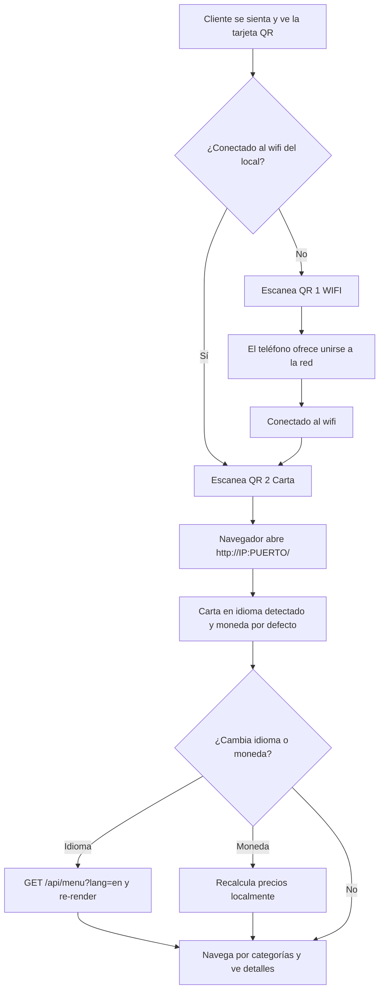
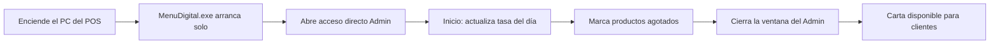
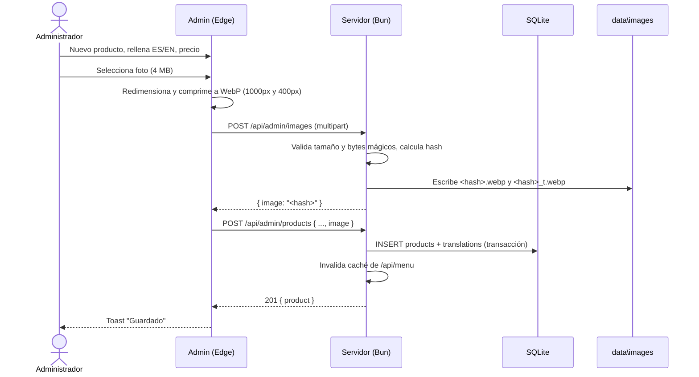
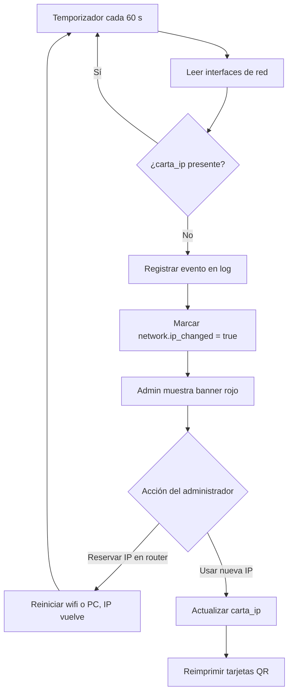
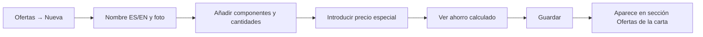
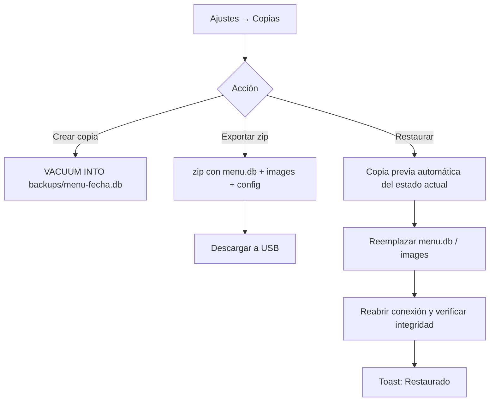

# 04 — Funciones y pantallas

Este documento describe **qué ve y hace** cada usuario. Las referencias `RF-xx` remiten a [02-requisitos-funcionales.md](02-requisitos-funcionales.md).

> **Nota sobre el diseño:** la apariencia visual final de la **Carta** la creará Jhon Alex con una IA de diseño y se integrará directamente en `src/carta` (ADR-06). Aquí se definen **estructura, contenido y comportamiento**, no colores ni tipografías. El Admin usa un estilo sobrio y funcional propio (CSS sencillo).

---

## Parte A — Admin (`http://localhost:PUERTO/admin`)

### A.0 Estructura general

```
┌───────────────────────────────────────────────────────────────────────┐
│ [Logo] Menú Digital — Admin          IP: 192.168.1.50 ● OK   [Ver carta]│
├──────────────┬────────────────────────────────────────────────────────┤
│ ▸ Inicio     │ ⚠ (Banner de avisos: cambio de IP, traducciones, etc.) │
│ ▸ Categorías │                                                        │
│ ▸ Productos  │               Área de contenido                        │
│ ▸ Ofertas    │                                                        │
│ ▸ Monedas    │                                                        │
│ ▸ Idiomas    │                                                        │
│ ▸ Red y QR   │                                                        │
│ ▸ Ajustes    │                                                        │
└──────────────┴────────────────────────────────────────────────────────┘
```

- **Tipo de aplicación:** SPA ligera (TypeScript + DOM nativo o micro-librería, ver ADR-09), enrutada por hash (`/admin#/productos`) para que recargar no rompa nada.
- **Resolución objetivo:** 1366×768 (típica de un portátil/PC de 2012, *Supuesto*); usable desde 1024×768.
- **Barra superior:** estado de la IP (verde OK / rojo cambiada), botón "Ver carta" (RF-54).
- **Banner de avisos:** cambio de IP (RF-37), copia de seguridad fallida, traducciones faltantes (RF-34, informativo).
- **Notificaciones (toasts):** "Guardado", "Error: …" — en la esquina inferior derecha, 3 s.
- **Atajos:** `Ctrl+S` guardar formulario, `Esc` cerrar diálogo, `/` enfocar búsqueda.

### A.1 Inicio (panel rápido)

Objetivo: las tareas **diarias** en una pantalla.

| Bloque | Contenido | Requisitos |
|--------|-----------|------------|
| **Tasa del día** | Por cada moneda activa no base: campo "1 USD = [ 400 ] CUP" + botón Guardar + "actualizada hace 2 h" | RF-27, RF-29 |
| **Disponibilidad rápida** | Buscador + lista compacta de productos con interruptor Disponible/Agotado; filtro "solo agotados"; botón "Marcar todo disponible" | RF-16 |
| **Estado del sistema** | URL de la carta, IP, puerto, última copia de seguridad, RAM del proceso | RF-36, RF-50, RF-55 |
| **Accesos** | "Imprimir tarjeta QR", "Nuevo producto", "Ver carta" | RF-38, RF-14 |

### A.2 Categorías

**Lista**

| ⠿ | Nombre (ES) | EN | Productos | Visible | Acciones |
|---|-------------|----|-----------|---------|----------|
| ⠿ | Entrantes | ✔ | 8 | ● | ✏ 🗑 |
| ⠿ | Plato Fuerte | ✔ | 12 | ● | ✏ 🗑 |
| ⠿ | Cócteles | ✖ (falta) | 10 | ● | ✏ 🗑 |
| ⠿ | Artículos | ✔ | 3 | ○ | ✏ 🗑 |

- `⠿` = asa para arrastrar (RF-11). Botones ↑/↓ alternativos (accesibles por teclado).
- "EN ✖" indica traducción faltante (RF-34).
- 🗑 deshabilitado si la categoría tiene productos (tooltip: "Mueva u oculte los productos primero", RF-13).

**Formulario (diálogo)**
- Pestañas de idioma: `[ES*] [EN] [+ otros activos]`.
- Campos por idioma: *Nombre* (obligatorio en ES, máx. 80), *Descripción* (opcional, máx. 300).
- Campos comunes: *Imagen/icono* (opcional), *Visible* (interruptor).
- Botones: Guardar · Cancelar.

### A.3 Productos

**Lista** con filtros (RF-19): `[Buscar…] [Categoría ▾] [Tipo ▾] [Estado ▾] [Sin traducir ☐]`

| ⠿ | Foto | Nombre | Categoría | Tipo | Precio base | Disponible | Visible | Acciones |
|---|------|--------|-----------|------|-------------|------------|---------|----------|
| ⠿ | 🖼 | Tostones rellenos | Entrantes | comida | 850 CUP | [■ ON] | ● | ✏ ⧉ 🗑 |
| ⠿ | 🖼 | Mojito | Cócteles | bebida | 1.200 CUP | [□ OFF] Agotado | ● | ✏ ⧉ 🗑 |
| ⠿ | — | Jabita de nailon | Artículos | articulo | 50 CUP | [■ ON] | ● | ✏ ⧉ 🗑 |

- Reordenar solo cuando el filtro de categoría tiene **una** categoría seleccionada (el orden es por categoría, RF-17).
- ⧉ = duplicar producto (*Could*), útil para variantes.
- Interruptor Disponible guarda al instante (RF-16) con "deshacer" 5 s (*Could*).

**Formulario de producto**

```
┌─ Producto ───────────────────────────────────────────────────────┐
│ Categoría: [Cócteles ▾]   Tipo: (•) Bebida ( ) Comida ( ) Artículo │
│ Precio base (CUP): [ 1200 ]  → Vista: $3.00 USD                    │
│ ┌ [ES*] [EN] ──────────────────────────────────────────────────┐ │
│ │ Nombre:       [ Mojito                         ]              │ │
│ │ Descripción:  [ Ron blanco, hierbabuena, lima… ]  120/500     │ │
│ └───────────────────────────────────────────────────────────────┘ │
│ Foto: [ 🖼 vista previa ]  [Cambiar…] [Quitar]   (arrastrar aquí)  │
│ ☑ Disponible   ☑ Visible en la carta                               │
│                                          [Cancelar] [Guardar]      │
└──────────────────────────────────────────────────────────────────┘
```

- El campo de precio muestra en vivo la conversión a las demás monedas activas (RF-27/28).
- La foto se comprime en el navegador antes de subir; se muestra el tamaño resultante ("4,1 MB → 96 KB") (RF-20).
- Validaciones en línea: nombre ES obligatorio, precio entero/decimal válido ≥ 0.

### A.4 Ofertas

**Lista**: igual que categorías (orden, visible, disponible) + columna *Precio especial* y *Componentes*.

**Formulario de oferta**
- Pestañas de idioma (nombre, descripción).
- *Precio especial* (moneda base).
- *Componentes*: buscador de productos → añadir; tabla `Producto | Cantidad [−][2][+] | Precio unitario | Subtotal | ✖`.
- Resumen: "Suma normal: 2.900 CUP · Precio oferta: 2.400 CUP · Ahorro: 500 CUP (17 %)" (RF-25).
- *Mostrar ahorro en la carta* ☐ (RF-25), *Disponible* ☑, *Visible* ☑, foto opcional.
- Aviso si algún componente está agotado: "Esta oferta aparecerá como agotada porque 'Mojito' está agotado" (RF-24).

### A.5 Monedas

| Base | Código | Nombre | Símbolo | Decimales | Redondeo | Tasa | Activa | Acciones |
|------|--------|--------|---------|-----------|----------|------|--------|----------|
| (•) | CUP | Peso cubano | CUP | 0 | ninguno | — (base) | ● | ✏ |
| ( ) | USD | Dólar EE. UU. | $ | 2 | hacia arriba a 0.50 | 1 USD = 400 CUP | ● | ✏ 🗑 |
| ( ) | EUR | Euro | € | 2 | al más cercano 0.10 | 1 EUR = 430 CUP | ○ | ✏ 🗑 |

> Las tasas mostradas son **ejemplos ilustrativos**, no valores reales.

- Cambiar la base muestra diálogo de advertencia (RF-26).
- Vista previa: "Un producto de 1.250 CUP se mostrará como $3.50" (con el redondeo aplicado).
- Selector *Moneda por defecto en la carta* (RF-43) y *Mostrar segunda moneda* (opcional).

### A.6 Idiomas y traducciones

- **Lista de idiomas**: `es` (base, fijo), `en`, + "Añadir idioma" (código, nombre nativo, activo).
- **Progreso por idioma**: "EN: 42/45 elementos traducidos (93 %)" con enlace "Ver faltantes" (RF-34).
- **Editor de traducción masiva** (*Should*): tabla de dos columnas `Español | Idioma destino` para categorías, productos y ofertas, editable en línea, para traducir rápidamente.
- **Textos de la interfaz** de la Carta (RF-33): tabla clave → texto por idioma ("offers" → "Ofertas" / "Offers").

### A.7 Red y QR

```
┌─ Red ─────────────────────────────────────────────────────────────┐
│ IP para la carta:  (•) 192.168.1.50  (Wi-Fi)   ( ) 192.168.56.1   │
│ Puerto: 8080            URL de la carta: http://192.168.1.50:8080/ │
│ Estado: ● Coincide con la IP guardada                              │
│ ℹ Recomendado: reservar esta IP en el router (MAC: 00-1A-2B-…)    │
├─ Wifi para clientes ──────────────────────────────────────────────┤
│ Nombre (SSID): [ Restaurante-Clientes ]   Oculta: ☐                │
│ Seguridad: [WPA/WPA2/WPA3 ▾]   Contraseña: [ •••••••• ] 👁          │
├─ Tarjeta QR ──────────────────────────────────────────────────────┤
│ [ Vista previa de la tarjeta con QR Wifi + QR Carta ]              │
│ Tamaño: [A6 ▾]  Copias por hoja: [4 ▾]  Mostrar contraseña: ☑      │
│ [Imprimir]  [Descargar QR wifi (SVG/PNG)]  [Descargar QR carta]    │
└───────────────────────────────────────────────────────────────────┘
```

- La MAC del adaptador se muestra para facilitar la reserva DHCP en el router (09).
- Si la IP cambió (RF-37): el estado pasa a rojo y aparece "Usar nueva IP" → actualiza `network.carta_ip` y recuerda reimprimir.

**Tarjeta imprimible (`/admin/qr/card`)**

```
┌──────────────────────────────────────────────┐
│            🍽  NOMBRE DEL RESTAURANTE         │
│                                              │
│   ┌────────┐               ┌────────┐        │
│   │ QR     │               │ QR     │        │
│   │ WIFI   │               │ CARTA  │        │
│   └────────┘               └────────┘        │
│ 1. Conéctate al wifi      2. Abre la carta    │
│    1. Join the wifi          2. Open the menu │
│ Red: Restaurante-Clientes                     │
│ Clave: ********                               │
│ http://192.168.1.50:8080/                     │
└──────────────────────────────────────────────┘
```

### A.8 Ajustes

Pestañas:
1. **General** (RF-53): nombre del restaurante, logo, mensaje de bienvenida y pie (por idioma), idioma por defecto, moneda por defecto, mostrar tasa en la carta, posición de agotados, PIN del Admin (RF-07).
2. **Imágenes**: calidad WebP, tamaños; "Limpiar imágenes huérfanas" (RF-21).
3. **Copias de seguridad** (RF-50–52): lista de copias (fecha, tamaño) con "Restaurar"; "Crear copia ahora"; "Exportar copia completa (.zip)"; "Importar copia".
4. **Diagnóstico** (RF-55): versión, ruta de datos, puerto, uptime, RAM, tamaño de la BD, últimas 200 líneas de log, botón "Copiar diagnóstico".

---

## Parte B — Carta (`http://IP:PUERTO/`)

### B.0 Principios
- Móvil primero (360–430 px), una columna; en tablet, 2 columnas.
- Carga mínima: HTML + 1 CSS + 1 JS pequeños, datos desde `/api/menu`.
- Sin inicio de sesión, sin cookies (solo `localStorage` para idioma y moneda).

### B.1 Pantalla principal

```
┌──────────────────────────────┐
│ [Logo] Nombre restaurante    │
│              [ES ▾] [CUP ▾]  │  ← selectores (RF-42, RF-43)
│ Bienvenidos…                 │
├──────────────────────────────┤
│ Ofertas | Entrantes | Plato… │  ← barra sticky de categorías (RF-41)
├──────────────────────────────┤
│ ★ OFERTAS                    │
│ ┌──────────────────────────┐ │
│ │ 🖼 Combo Cuba Libre      │ │
│ │ 2× Cuba Libre, 1× Tostón │ │
│ │ 2.400 CUP   Ahorra 500   │ │
│ └──────────────────────────┘ │
│ ENTRANTES                    │
│ ┌────┐ Tostones rellenos     │
│ │ 🖼 │ Plátano verde con…    │
│ └────┘            850 CUP    │
│ ┌────┐ Croquetas  AGOTADO    │  ← atenuado (RF-44)
│ └────┘            600 CUP    │
│ …                            │
├──────────────────────────────┤
│ Tasa del día: 1 USD = 400 CUP│  ← opcional (RF-29)
│ Pie de página                │
└──────────────────────────────┘
```

### B.2 Detalle de producto (RF-46)
- Capa a pantalla completa (o *bottom sheet*): imagen grande, nombre, descripción completa, precio (y segunda moneda si está activa), estado.
- Se cierra con ✖, tocando fuera o con el botón "Atrás" del teléfono (se usa `history.pushState`).

### B.3 Selectores de idioma y moneda
- Desplegables nativos (`<select>`) para máxima compatibilidad y accesibilidad, o botones compactos según el diseño final.
- El idioma muestra nombres nativos ("Español", "English").

### B.4 Estados especiales

| Estado | Comportamiento |
|--------|----------------|
| Cargando | Esqueleto (*skeleton*) de tarjetas, sin spinners pesados |
| Sin ofertas | La sección "Ofertas" no aparece |
| Menú vacío | Mensaje "La carta se está actualizando" |
| Error de red | "No se pudo cargar la carta. Comprueba que estás conectado al wifi del restaurante." + botón "Reintentar" |
| Imagen sin foto | Placeholder del diseño (SVG ligero), no imagen rota |

---

## Parte C — Flujos de usuario

### C.1 Cliente: del QR a la carta



> **Advertencia:** algunos teléfonos, al unirse a un wifi **sin internet**, muestran "Sin conexión a internet" y pueden preferir los datos móviles. La Carta sigue siendo accesible por la IP local en la mayoría de casos; si un teléfono enruta por datos móviles, el cliente debe aceptar "Mantener conexión wifi". Se recomienda añadir este aviso en la tarjeta (*Supuesto*: el wifi de clientes podría no tener internet).

### C.2 Personal: inicio de jornada



### C.3 Administrador: crear un producto con foto



### C.4 Cambio de IP detectado



### C.5 Crear oferta/combo



### C.6 Copia de seguridad y restauración


