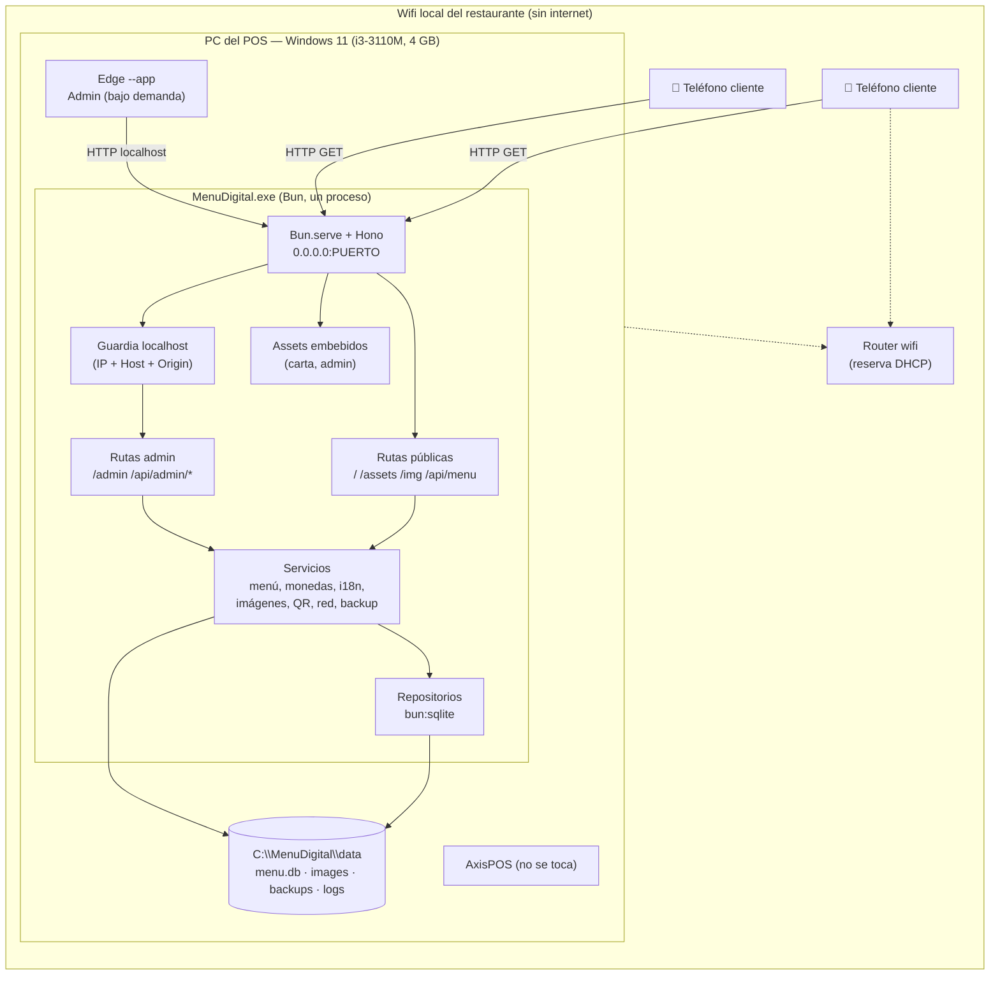
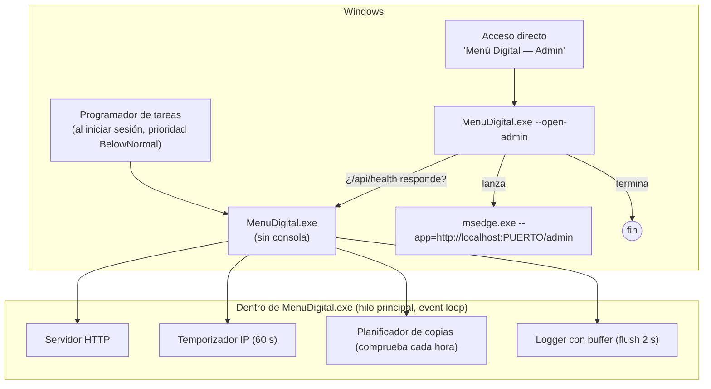
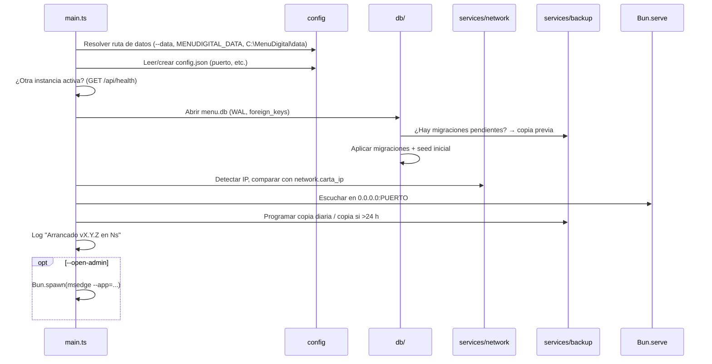
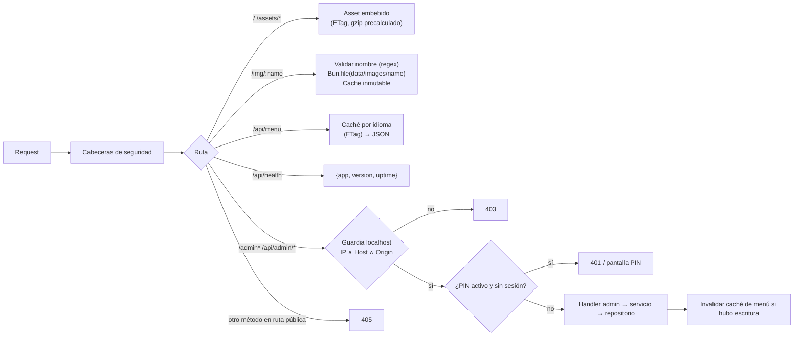

# 05 — Arquitectura

## 1. Vista general

DigitalMenu es un **monolito local**: un único proceso Bun compilado (`MenuDigital.exe`) que contiene servidor HTTP, lógica, migraciones y los recursos estáticos de Admin y Carta. Los **datos** (SQLite + imágenes) viven fuera del ejecutable.



### Principios

1. **Un proceso, un puerto, un ejecutable.** Sin servicios auxiliares, sin base de datos externa.
2. **Ligereza ante todo** (RNF-02): sin procesamiento de imágenes en el servidor, caché pequeña, streaming de archivos.
3. **Servidor sin estado de sesión** para la Carta; el Admin solo depende del control localhost (+ PIN opcional).
4. **Datos fuera del ejecutable**: actualizar = reemplazar el `.exe`.
5. **Código compartido** (`src/shared`) para dinero, i18n y tipos de la API, usado por servidor, Admin y Carta.

## 2. Modelo de procesos



| Elemento | Detalle |
|----------|---------|
| Proceso servidor | 1 proceso `MenuDigital.exe`, un hilo JS (event loop). Sin `Worker`s en la Fase 1. |
| Edge (Admin) | Proceso independiente, lanzado bajo demanda; su cierre no afecta al servidor. |
| Arranque | Tarea programada al iniciar sesión del usuario del POS (ver 09). |
| Instancia única | Antes de escuchar, se intenta `GET http://127.0.0.1:PUERTO/api/health`; si responde `{"app":"DigitalMenu"}`, la nueva instancia no arranca servidor (RF-04). Si `Bun.serve` falla con `EADDRINUSE`, error y salida. |
| Parada | `SIGINT`/`SIGTERM`/cierre: cerrar servidor, `flush` del log, `db.close()`. Windows no siempre envía señales; por eso SQLite en WAL garantiza consistencia aunque se mate el proceso. |
| Prioridad | `BelowNormal` (vía tarea programada o `os.setPriority()` al arrancar, *Supuesto*: verificar soporte en Bun/Windows). |

### Secuencia de arranque



## 3. Pila tecnológica

| Capa | Tecnología | Motivo |
|------|-----------|--------|
| Lenguaje | TypeScript (strict) | Un solo lenguaje en servidor y navegador |
| Runtime / build | Bun 1.4.3 (desarrollo), `bun build --compile --target=bun-windows-x64-baseline` | Ejecutable único, compatible sin AVX2 (ADR-01, ADR-02) |
| HTTP | `Bun.serve` + **Hono** (enrutado y middlewares, ~14 KB) | Ligero, tipado; `Bun.serve` puro es alternativa válida (ADR-04) |
| BD | `bun:sqlite` | Integrada en Bun, sin módulos nativos externos (ADR-05) |
| Admin UI | HTML + CSS + TypeScript con DOM nativo (o micro-librería tipo Preact/lit-html si hiciera falta, ≤ 10 KB) | Bajo consumo en Edge, sin build complejo |
| Carta UI | HTML + CSS + TS vanilla; diseño integrado de la IA de diseño | RNF-06 (≤ 60 KB) |
| QR | `qrcode-generator` (JS puro) → SVG | Sin internet, sin nativo |
| Zip de copias | `fflate` (JS puro) | Exportar/importar copias completas |
| Validación | Validadores propios o `zod` (ADR-09) | Seguridad de entradas |
| Pruebas | `bun test` | Integrado |
| Formato/lint | Biome (*Supuesto*) | Un binario, rápido |

## 4. Pipeline de una petición



### Guardia localhost (esbozo)

```ts
// src/server/middleware/localOnly.ts
import type { MiddlewareHandler } from "hono";
import { getConnInfo } from "hono/bun";

const LOOPBACK = new Set(["127.0.0.1", "::1", "::ffff:127.0.0.1"]);

export const localOnly = (port: number): MiddlewareHandler => async (c, next) => {
  const ip = getConnInfo(c).remote.address ?? "";
  const host = (c.req.header("host") ?? "").toLowerCase();
  const okHost = host === `localhost:${port}` || host === `127.0.0.1:${port}`;
  if (!LOOPBACK.has(ip) || !okHost) return c.text("Forbidden", 403);

  if (!["GET", "HEAD", "OPTIONS"].includes(c.req.method)) {
    const origin = c.req.header("origin");
    const okOrigin = origin === `http://localhost:${port}` || origin === `http://127.0.0.1:${port}`;
    if (!okOrigin) return c.text("Forbidden", 403);
  }
  await next();
};
```

```ts
// src/server/main.ts (extracto)
const app = createApp(ctx);               // Hono con rutas públicas y /admin
Bun.serve({
  hostname: "0.0.0.0",
  port: ctx.config.port,
  maxRequestBodySize: 3 * 1024 * 1024,    // 3 MB (imágenes ya comprimidas)
  fetch: (req, server) => app.fetch(req, server), // Hono recibe server como env (getConnInfo)
});
```

## 5. Caché y frescura

| Recurso | Estrategia |
|---------|-----------|
| `/api/menu?lang=xx` | JSON construido una vez por idioma y guardado en memoria con su `ETag` (hash). Se invalida en cualquier escritura del Admin (contador de versión `menuVersion`). Respuesta `Cache-Control: no-cache` + `ETag` → 304 si no cambió. |
| `/img/*` | Nombre por hash de contenido → `Cache-Control: public, max-age=31536000, immutable`. |
| `/assets/*` (carta/admin) | Nombres con hash generados en el build → inmutables; `index.html` con `no-cache`. Variantes `.gz` precalculadas en el build y servidas si `Accept-Encoding: gzip`. |

## 6. Estructura del proyecto

```
DigitalMenu/
├─ package.json
├─ bun.lock
├─ tsconfig.json
├─ biome.json
├─ bunfig.toml
├─ README.md
├─ Docs/                         ← esta documentación
├─ assets/
│  └─ icon.ico                   ← icono del .exe (--windows-icon)
├─ scripts/
│  ├─ build.ts                   ← build de web + manifiesto + compile
│  ├─ gen-assets-manifest.ts     ← genera src/server/assets.generated.ts
│  ├─ check-budget.ts            ← presupuesto de peso de la carta (RNF-06)
│  ├─ load.ts                    ← prueba de carga (RNF-04)
│  ├─ install.ps1                ← instalación en el POS (09)
│  ├─ uninstall.ps1
│  └─ soak.ps1                   ← medición de RAM a largo plazo
├─ src/
│  ├─ shared/                    ← código usado por servidor y navegador
│  │  ├─ money.ts                ← conversión, redondeo, formato
│  │  ├─ i18n.ts                 ← resolución de idioma y fallback
│  │  ├─ api-types.ts            ← tipos de request/response
│  │  └─ wifi.ts                 ← construcción/escape de la cadena WIFI:
│  ├─ server/
│  │  ├─ main.ts                 ← punto de entrada: config, DB, servidor, timers
│  │  ├─ app.ts                  ← crea la app Hono y monta rutas
│  │  ├─ config.ts               ← ruta de datos, config.json, argumentos CLI
│  │  ├─ logger.ts               ← log a archivo con rotación
│  │  ├─ assets.generated.ts     ← (generado) imports `with { type: "file" }`
│  │  ├─ middleware/
│  │  │  ├─ localOnly.ts
│  │  │  ├─ securityHeaders.ts
│  │  │  └─ adminPin.ts
│  │  ├─ routes/
│  │  │  ├─ public.ts            ← /, /assets, /img, /api/menu, /api/health
│  │  │  └─ admin.ts             ← /admin, /api/admin/*
│  │  ├─ db/
│  │  │  ├─ index.ts             ← abrir BD, PRAGMAs
│  │  │  ├─ migrate.ts           ← aplica migraciones embebidas
│  │  │  ├─ migrations/
│  │  │  │  ├─ 001_init.sql
│  │  │  │  └─ 002_seed.sql
│  │  │  └─ repos/               ← categories.ts, products.ts, offers.ts,
│  │  │                            currencies.ts, languages.ts, translations.ts, settings.ts
│  │  └─ services/
│  │     ├─ menu.ts              ← compone /api/menu (traducción + fallback + caché)
│  │     ├─ rates.ts             ← monedas y tasas
│  │     ├─ images.ts            ← validación, hash, guardado atómico, limpieza
│  │     ├─ qr.ts                ← SVG de QR (wifi y URL)
│  │     ├─ network.ts           ← detección de IP, vigilancia de cambios
│  │     ├─ backup.ts            ← VACUUM INTO, rotación, zip, restauración
│  │     └─ edge.ts              ← localizar msedge.exe y lanzar --app
│  ├─ admin/
│  │  ├─ index.html
│  │  ├─ main.ts                 ← router por hash, vistas
│  │  ├─ api.ts                  ← cliente fetch tipado
│  │  ├─ image-compress.ts       ← canvas → WebP (1000/400 px)
│  │  ├─ views/                  ← inicio, categorias, productos, ofertas,
│  │  │                            monedas, idiomas, red-qr, ajustes
│  │  ├─ components/             ← tabla ordenable, toggle, diálogo, toast, tabs-idioma
│  │  ├─ qr-card.html / qr-card.css  ← tarjeta imprimible
│  │  └─ styles.css
│  └─ carta/
│     ├─ index.html              ← diseño integrado (IA de diseño)
│     ├─ main.ts                 ← carga /api/menu, render, selectores
│     ├─ render.ts               ← plantillas DOM (textContent)
│     ├─ styles.css
│     ├─ i18n/
│     │  ├─ es.json
│     │  └─ en.json
│     └─ assets/                 ← fuentes WOFF2 (subset), SVG, placeholder
├─ tests/
│  ├─ money.test.ts
│  ├─ i18n.test.ts
│  ├─ wifi.test.ts
│  ├─ localOnly.test.ts
│  ├─ api-menu.test.ts
│  └─ migrations.test.ts
├─ data/                         ← datos de desarrollo (en .gitignore)
└─ dist/                         ← salida del build (en .gitignore)
   ├─ web/                       ← carta/ y admin/ compilados
   └─ MenuDigital.exe
```

### Scripts de `package.json` (propuesta)

```json
{
  "name": "digitalmenu",
  "version": "0.1.0",
  "private": true,
  "type": "module",
  "scripts": {
    "dev": "bun --watch src/server/main.ts --data ./data --dev",
    "build:web": "bun build src/carta/main.ts src/admin/main.ts --outdir dist/web --minify --target browser --entry-naming [dir]/[name]-[hash].[ext]",
    "build": "bun scripts/build.ts",
    "test": "bun test",
    "lint": "biome check .",
    "typecheck": "tsc --noEmit"
  },
  "dependencies": {
    "hono": "^4",
    "qrcode-generator": "^1.4",
    "fflate": "^0.8"
  },
  "devDependencies": {
    "@types/bun": "latest",
    "typescript": "^5",
    "@biomejs/biome": "^1"
  }
}
```

> **Supuesto:** se usa **bun** como gestor de paquetes (`bun install`, `bun.lock`) para mantener una sola herramienta. pnpm está instalado en la máquina de desarrollo pero no es necesario; no mezclar lockfiles.

En modo `--dev` el servidor sirve los archivos de `src/carta` y `src/admin` transpilados al vuelo (o desde `dist/web` con `--watch`), y desactiva la comprobación de `Host` para permitir herramientas de desarrollo (nunca en producción).

## 7. Embebido de recursos en el ejecutable

1. `bun run build:web` genera `dist/web/carta/*` y `dist/web/admin/*` (minificados, con hash) + copias `.gz`.
2. `scripts/gen-assets-manifest.ts` genera `src/server/assets.generated.ts`:

```ts
// GENERADO — no editar
import carta_index from "../../dist/web/carta/index.html" with { type: "file" };
import carta_main from "../../dist/web/carta/main-3f9a1c.js" with { type: "file" };
// ...
export const ASSETS: Record<string, { path: string; type: string }> = {
  "/": { path: carta_index, type: "text/html; charset=utf-8" },
  "/assets/main-3f9a1c.js": { path: carta_main, type: "text/javascript" },
  // ...
};
```

3. En tiempo de ejecución: `new Response(Bun.file(ASSETS[url].path), { headers })`. En el `.exe`, esas rutas apuntan al sistema de archivos embebido de Bun (`$bunfs`).
4. Las migraciones SQL se embeben con `import sql from "./migrations/001_init.sql" with { type: "text" }`.

> **Alternativa:** pasar los archivos como entradas adicionales a `bun build --compile` y listarlos con `Bun.embeddedFiles`. Se elegirá la que funcione mejor con Bun 1.4.3 en la Fase 0 (*Supuesto* a validar).

## 8. Carpeta de datos

Ruta por defecto en producción: **`C:\MenuDigital\data`** (resolución: `--data` → `MENUDIGITAL_DATA` → `C:\MenuDigital\data`; en desarrollo `./data`).

```
C:\MenuDigital\
├─ MenuDigital.exe              ← ejecutable (reemplazable)
├─ MenuDigital.prev.exe         ← versión anterior (rollback)
└─ data\
   ├─ config.json               ← puerto, opciones de arranque
   ├─ menu.db                   ← SQLite principal
   ├─ menu.db-wal               ← (WAL, gestionado por SQLite)
   ├─ menu.db-shm
   ├─ images\
   │  ├─ 9f2c1e7ab34d5e61.webp      ← grande (1000 px)
   │  └─ 9f2c1e7ab34d5e61_t.webp    ← miniatura (400 px)
   ├─ backups\
   │  ├─ menu-20261013-0400.db
   │  └─ full-20261013-1830.zip
   └─ logs\
      └─ menudigital-20261013.log
```

`config.json` (solo lo necesario **antes** de abrir la BD; el resto de ajustes va en la tabla `settings`):

```json
{
  "port": 8080,
  "host": "0.0.0.0",
  "edgePath": null,
  "logLevel": "info",
  "backup": { "keepDaily": 14, "hour": 4 }
}
```

## 9. Servicios clave (diseño)

### 9.1 `services/menu.ts`
- Lee categorías, productos, ofertas y traducciones con **pocas consultas** (una por tabla) y compone el árbol en memoria.
- Resuelve traducciones con fallback (`src/shared/i18n.ts`): `t(entity, id, lang) ?? t(entity, id, "es")`.
- Calcula la disponibilidad efectiva de ofertas (RF-24).
- Devuelve precios **en moneda base (unidades menores)** + lista de monedas con tasas; la conversión la hace el cliente con `src/shared/money.ts` (RF-43).

### 9.2 `shared/money.ts`
```ts
// Precio base en unidades menores (p. ej. CUP con 0 decimales → 1250 = 1.250 CUP;
// si la base tuviera 2 decimales, 125000 = 1.250,00)
export function convert(baseMinor: number, base: Currency, target: Currency): number {
  const baseValue = baseMinor / 10 ** base.decimals;          // en unidades de la base
  const raw = target.isBase ? baseValue : baseValue / target.basePerUnit;
  return round(raw, target.rounding, target.roundStep ?? 10 ** -target.decimals);
}
```
- `rounding`: `none` (redondeo bancario estándar a `decimals`), `up` (techo al paso), `nearest` (al paso más cercano).
- Pruebas obligatorias con casos límite (0, precios grandes, paso 0.50, tasa decimal).

### 9.3 `services/images.ts`
- Recibe `multipart/form-data` con `large` y `thumb` (ya WebP desde el navegador).
- Valida tamaño (≤ 2 MB) y bytes mágicos; hash `Bun.hash` / SHA-256 (`new Bun.CryptoHasher("sha256")`) truncado a 16 hex.
- Escritura atómica: `Bun.write(tmp)` → `fs.renameSync(tmp, final)`.
- Si el hash ya existe, reutiliza el archivo (deduplicación).

### 9.4 `services/network.ts`
- `os.networkInterfaces()` → IPv4 no internas, excluye `169.254.*` y adaptadores con nombres de virtualización (`vEthernet`, `VirtualBox`, `VMware`, `Hyper-V`) (*Supuesto*: lista ajustable).
- Prioriza rangos privados `192.168.*`, `10.*`, `172.16–31.*`.
- Vigilancia cada 60 s; estado expuesto en `GET /api/admin/network`.

### 9.5 `services/qr.ts` y `shared/wifi.ts`
```ts
const esc = (s: string) => s.replace(/([\\;,:"])/g, "\\$1");
export const wifiPayload = (w: { ssid: string; password: string; security: "WPA" | "WEP" | "nopass"; hidden: boolean }) =>
  `WIFI:T:${w.security};S:${esc(w.ssid)};${w.security === "nopass" ? "" : `P:${esc(w.password)};`}H:${w.hidden};;`;
```
- QR en SVG con nivel de corrección **M**, margen de 4 módulos.

### 9.6 `services/backup.ts`
- `db.run("VACUUM INTO ?", [ruta])` para copias consistentes en caliente.
- Rotación por número de copias; zip completo con `fflate` (en streaming si es posible para no cargar todas las imágenes en RAM; *Supuesto*: el volumen de imágenes, ~20–40 MB, es asumible incluso sin streaming, pero se prefiere `Zip` en streaming de `fflate`).

### 9.7 `services/edge.ts`
- Busca `msedge.exe` en `C:\Program Files (x86)\Microsoft\Edge\Application\msedge.exe` y `C:\Program Files\Microsoft\Edge\Application\msedge.exe` (o `config.edgePath`).
- `Bun.spawn([edge, "--app=http://localhost:PUERTO/admin", "--window-size=1280,760"], { stdio: ["ignore","ignore","ignore"] })` y `unref()`.
- *Opcional:* `--user-data-dir=C:\MenuDigital\edge-profile` para aislar el perfil del Admin del navegador normal (*Supuesto*: se decide en la Fase 0 según consumo).

## 10. Seguridad (vista de arquitectura)

| Amenaza | Control |
|---------|---------|
| Cliente en la LAN intenta entrar al Admin | Guardia IP loopback (RNF-20) |
| Página web maliciosa en el navegador del POS (CSRF) | Comprobación de `Origin` en escrituras |
| DNS rebinding | Comprobación de `Host` |
| Path traversal en `/img` | Regex estricta del nombre |
| XSS vía nombres de productos | `textContent` en render; CSP |
| Subida de archivos maliciosos | Bytes mágicos, tamaño, nombre por hash, servidos con `Content-Type` fijo y `nosniff` |
| Fuga de contraseña wifi | Nunca en `/api/menu`; solo en Admin |
| Denegación de servicio desde la LAN | `maxRequestBodySize`, caché de menú, límite simple de peticiones por IP (*Could*) |
