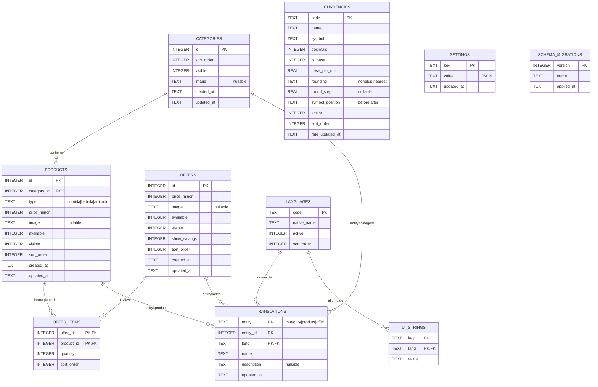

# 06 — Modelo de datos (SQLite)

## 1. Generalidades

- Motor: **SQLite** vía `bun:sqlite`, archivo `C:\MenuDigital\data\menu.db`.
- PRAGMAs al abrir la conexión:

```sql
PRAGMA journal_mode = WAL;        -- lecturas concurrentes, resistente a cortes
PRAGMA synchronous = NORMAL;      -- buen equilibrio con WAL (ver RNF-12)
PRAGMA foreign_keys = ON;         -- obligatorio: SQLite lo trae desactivado
PRAGMA busy_timeout = 3000;
PRAGMA cache_size = -4000;        -- ~4 MB de caché de páginas (RNF-02)
PRAGMA temp_store = MEMORY;
```

- **Precios**: enteros en **unidades menores** de la moneda base (`price_minor`). Si la base es CUP con 0 decimales, `1250` = 1.250 CUP; si fuera USD con 2 decimales, `350` = 3,50 USD. Nunca se guardan precios como `REAL`.
- **Booleanos**: `INTEGER` 0/1 con `CHECK (x IN (0,1))`.
- **Fechas**: `TEXT` ISO-8601 UTC (`strftime('%Y-%m-%dT%H:%M:%fZ','now')`); el Admin las muestra en hora local.
- **Textos traducibles**: no están en las tablas principales; viven en `translations`. El español (`es`) es obligatorio (validado por la aplicación).
- **Imágenes**: se guarda solo el **identificador por hash** (`image`), p. ej. `9f2c1e7ab34d5e61`; los archivos son `<hash>.webp` y `<hash>_t.webp` en `data\images`.

## 2. Diagrama entidad-relación



> `translations` es una tabla **polimórfica** (`entity` + `entity_id`): SQLite no puede declarar una FK a varias tablas, por eso la integridad se garantiza con **triggers** de borrado (sección 4) y con la capa de repositorios.

> **Supuesto / ampliación sobre lo acordado:** además de las tablas sugeridas (categories, products, translations, offers, offer_items, currencies, settings) se añaden `languages` (catálogo de idiomas activos), `ui_strings` (textos fijos de la Carta para idiomas añadidos desde el Admin, RF-33) y `schema_migrations` (control de versiones del esquema, RNF-52).

## 3. Definición de tablas

### 3.1 `languages`

| Columna | Tipo | Restricciones | Descripción |
|---------|------|---------------|-------------|
| `code` | TEXT | PK, `CHECK (length(code) BETWEEN 2 AND 10)` | Código BCP-47 corto: `es`, `en`, `fr`, `pt-BR` |
| `native_name` | TEXT | NOT NULL | "Español", "English" |
| `active` | INTEGER | NOT NULL DEFAULT 1, CHECK 0/1 | Visible en el selector de la Carta |
| `sort_order` | INTEGER | NOT NULL DEFAULT 0 | Orden en el selector |

Regla: `es` siempre existe y `active = 1` (trigger `languages_protect_es`).

### 3.2 `categories`

| Columna | Tipo | Restricciones | Descripción |
|---------|------|---------------|-------------|
| `id` | INTEGER | PK AUTOINCREMENT | |
| `sort_order` | INTEGER | NOT NULL DEFAULT 0 | Orden en la Carta (RF-11) |
| `visible` | INTEGER | NOT NULL DEFAULT 1, CHECK 0/1 | RF-12 |
| `image` | TEXT | NULL, `CHECK (image GLOB '[0-9a-f]*')` | Hash de imagen/icono |
| `created_at` | TEXT | NOT NULL DEFAULT now | |
| `updated_at` | TEXT | NOT NULL DEFAULT now | |

### 3.3 `products`

| Columna | Tipo | Restricciones | Descripción |
|---------|------|---------------|-------------|
| `id` | INTEGER | PK AUTOINCREMENT | |
| `category_id` | INTEGER | NOT NULL, FK → `categories(id)` ON DELETE RESTRICT | RF-13 |
| `type` | TEXT | NOT NULL, `CHECK (type IN ('comida','bebida','articulo'))` | RF-15 |
| `price_minor` | INTEGER | NOT NULL, `CHECK (price_minor BETWEEN 0 AND 1000000000)` | Precio base en unidades menores |
| `image` | TEXT | NULL | Hash de imagen |
| `available` | INTEGER | NOT NULL DEFAULT 1, CHECK 0/1 | Disponible (1) / agotado (0), RF-16 |
| `visible` | INTEGER | NOT NULL DEFAULT 1, CHECK 0/1 | RF-18 |
| `sort_order` | INTEGER | NOT NULL DEFAULT 0 | Orden dentro de la categoría |
| `ingredients_es` | TEXT | NULL | Ingredientes (texto libre, ES); migración `003` |
| `ingredients_en` | TEXT | NULL | Ingredientes (EN); si vacío, la carta usa ES |
| `allergens` | TEXT | NULL | JSON de códigos UE, p. ej. `["gluten","lacteos"]` |
| `created_at`, `updated_at` | TEXT | NOT NULL DEFAULT now | |

Índices: `idx_products_category_order (category_id, sort_order)`.

Códigos de alérgeno admitidos (14 UE): `gluten`, `crustaceos`, `huevo`, `pescado`, `cacahuete`, `soja`, `lacteos`, `frutos_cascara`, `apio`, `mostaza`, `sesamo`, `sulfitos`, `altramuces`, `moluscos`.

### 3.4 `offers`

| Columna | Tipo | Restricciones | Descripción |
|---------|------|---------------|-------------|
| `id` | INTEGER | PK AUTOINCREMENT | |
| `price_minor` | INTEGER | NOT NULL, CHECK ≥ 0 | Precio especial (moneda base) |
| `image` | TEXT | NULL | |
| `available` | INTEGER | NOT NULL DEFAULT 1, CHECK 0/1 | Disponibilidad manual (RF-24) |
| `visible` | INTEGER | NOT NULL DEFAULT 1, CHECK 0/1 | |
| `show_savings` | INTEGER | NOT NULL DEFAULT 0, CHECK 0/1 | RF-25 |
| `sort_order` | INTEGER | NOT NULL DEFAULT 0 | |
| `created_at`, `updated_at` | TEXT | NOT NULL DEFAULT now | |

> Fase 2 (ofertas por horario) añadiría `valid_from`, `valid_to`, `days_mask`, `time_from`, `time_to` — **no** en la Fase 1.

### 3.5 `offer_items`

| Columna | Tipo | Restricciones | Descripción |
|---------|------|---------------|-------------|
| `offer_id` | INTEGER | NOT NULL, FK → `offers(id)` ON DELETE CASCADE | |
| `product_id` | INTEGER | NOT NULL, FK → `products(id)` ON DELETE RESTRICT | No se borra un producto incluido en ofertas (RF-14) |
| `quantity` | INTEGER | NOT NULL DEFAULT 1, `CHECK (quantity BETWEEN 1 AND 99)` | |
| `sort_order` | INTEGER | NOT NULL DEFAULT 0 | |
| | | PK (`offer_id`, `product_id`) | Sin duplicados (RF-23) |

### 3.6 `translations`

| Columna | Tipo | Restricciones | Descripción |
|---------|------|---------------|-------------|
| `entity` | TEXT | NOT NULL, `CHECK (entity IN ('category','product','offer'))` | Tipo de elemento |
| `entity_id` | INTEGER | NOT NULL | Id en la tabla correspondiente |
| `lang` | TEXT | NOT NULL, FK → `languages(code)` ON DELETE CASCADE | |
| `name` | TEXT | NOT NULL, `CHECK (length(trim(name)) BETWEEN 1 AND 80)` | |
| `description` | TEXT | NULL, `CHECK (description IS NULL OR length(description) <= 500)` | |
| `updated_at` | TEXT | NOT NULL DEFAULT now | |
| | | PK (`entity`, `entity_id`, `lang`) | |

Índice adicional: `idx_translations_lang (lang, entity)` para construir el menú por idioma.

### 3.7 `currencies`

| Columna | Tipo | Restricciones | Descripción |
|---------|------|---------------|-------------|
| `code` | TEXT | PK, `CHECK (length(code) BETWEEN 2 AND 8)` | `CUP`, `USD`, `EUR`, `MLC` |
| `name` | TEXT | NOT NULL | "Peso cubano" |
| `symbol` | TEXT | NOT NULL | "CUP", "$", "€" |
| `decimals` | INTEGER | NOT NULL DEFAULT 2, `CHECK (decimals BETWEEN 0 AND 4)` | |
| `is_base` | INTEGER | NOT NULL DEFAULT 0, CHECK 0/1 | Índice único parcial: solo una base |
| `base_per_unit` | REAL | NOT NULL DEFAULT 1, `CHECK (base_per_unit > 0)` | Cuántas unidades de la base vale 1 unidad de esta moneda. Para la base = 1 |
| `rounding` | TEXT | NOT NULL DEFAULT 'nearest', `CHECK (rounding IN ('none','up','nearest'))` | RF-28 |
| `round_step` | REAL | NULL, `CHECK (round_step IS NULL OR round_step > 0)` | Paso de redondeo (5, 0.5…) |
| `symbol_position` | TEXT | NOT NULL DEFAULT 'before', CHECK IN ('before','after') | `$3.00` vs `1.250 CUP` |
| `active` | INTEGER | NOT NULL DEFAULT 1, CHECK 0/1 | |
| `sort_order` | INTEGER | NOT NULL DEFAULT 0 | |
| `rate_updated_at` | TEXT | NULL | RF-29 |

Regla: la moneda base debe tener `base_per_unit = 1` y `active = 1` (trigger).

### 3.8 `settings`

| Columna | Tipo | Restricciones | Descripción |
|---------|------|---------------|-------------|
| `key` | TEXT | PK | Clave con prefijo por ámbito |
| `value` | TEXT | NOT NULL, `CHECK (json_valid(value))` | Valor JSON |
| `updated_at` | TEXT | NOT NULL DEFAULT now | |

Claves previstas:

| Clave | Ejemplo | Pública en `/api/menu` |
|-------|---------|------------------------|
| `carta.restaurant_name` | `"Paladar La Esquina"` | Sí |
| `carta.logo` | `"ab12cd34ef56ab78"` | Sí |
| `carta.welcome` | `{"es":"Bienvenidos","en":"Welcome"}` | Sí |
| `carta.footer` | `{"es":"Precios con impuestos incluidos"}` | Sí |
| `carta.default_lang` | `"es"` | Sí |
| `carta.default_currency` | `"CUP"` | Sí |
| `carta.show_rate` | `true` | Sí |
| `carta.second_currency` | `"USD"` o `null` | Sí |
| `carta.soldout_position` | `"inline"` \| `"end"` | Sí |
| `wifi.ssid` | `"Restaurante-Clientes"` | **No** |
| `wifi.password` | `"********"` | **No** |
| `wifi.security` | `"WPA"` | **No** |
| `wifi.hidden` | `false` | **No** |
| `network.carta_ip` | `"192.168.1.50"` | **No** |
| `network.ip_changed` | `false` | **No** |
| `admin.pin_hash` | `null` o hash | **No** |
| `images.quality` | `0.75` | **No** |
| `images.max_large` / `images.max_thumb` | `1000` / `400` | **No** |
| `backup.last_at` | `"2026-10-13T08:00:00Z"` | **No** |

Solo las claves `carta.*` se exponen públicamente (RNF-24).

### 3.9 `ui_strings` (*Should*)

| Columna | Tipo | Restricciones |
|---------|------|---------------|
| `key` | TEXT | NOT NULL (`offers`, `sold_out`, `language`, `currency`, `rate_of_day`, `retry`, …) |
| `lang` | TEXT | NOT NULL, FK → `languages(code)` ON DELETE CASCADE |
| `value` | TEXT | NOT NULL, longitud ≤ 200 |
| | | PK (`key`, `lang`) |

Los textos para `es` y `en` vienen en `src/carta/i18n/*.json` (embebidos); `ui_strings` permite **sobrescribirlos** o añadir idiomas nuevos sin recompilar.

### 3.10 `schema_migrations`

| Columna | Tipo | Restricciones |
|---------|------|---------------|
| `version` | INTEGER | PK |
| `name` | TEXT | NOT NULL |
| `applied_at` | TEXT | NOT NULL DEFAULT now |

## 4. DDL de la migración inicial (`001_init.sql`)

```sql
CREATE TABLE IF NOT EXISTS schema_migrations (
  version    INTEGER PRIMARY KEY,
  name       TEXT NOT NULL,
  applied_at TEXT NOT NULL DEFAULT (strftime('%Y-%m-%dT%H:%M:%fZ','now'))
);

CREATE TABLE languages (
  code        TEXT PRIMARY KEY CHECK (length(code) BETWEEN 2 AND 10),
  native_name TEXT NOT NULL,
  active      INTEGER NOT NULL DEFAULT 1 CHECK (active IN (0,1)),
  sort_order  INTEGER NOT NULL DEFAULT 0
);

CREATE TABLE categories (
  id         INTEGER PRIMARY KEY AUTOINCREMENT,
  sort_order INTEGER NOT NULL DEFAULT 0,
  visible    INTEGER NOT NULL DEFAULT 1 CHECK (visible IN (0,1)),
  image      TEXT,
  created_at TEXT NOT NULL DEFAULT (strftime('%Y-%m-%dT%H:%M:%fZ','now')),
  updated_at TEXT NOT NULL DEFAULT (strftime('%Y-%m-%dT%H:%M:%fZ','now'))
);

CREATE TABLE products (
  id          INTEGER PRIMARY KEY AUTOINCREMENT,
  category_id INTEGER NOT NULL REFERENCES categories(id) ON DELETE RESTRICT,
  type        TEXT NOT NULL CHECK (type IN ('comida','bebida','articulo')),
  price_minor INTEGER NOT NULL CHECK (price_minor BETWEEN 0 AND 1000000000),
  image       TEXT,
  available   INTEGER NOT NULL DEFAULT 1 CHECK (available IN (0,1)),
  visible     INTEGER NOT NULL DEFAULT 1 CHECK (visible IN (0,1)),
  sort_order  INTEGER NOT NULL DEFAULT 0,
  -- 003_product_ingredients:
  ingredients_es TEXT,
  ingredients_en TEXT,
  allergens      TEXT, -- JSON ["gluten","lacteos",…]
  created_at  TEXT NOT NULL DEFAULT (strftime('%Y-%m-%dT%H:%M:%fZ','now')),
  updated_at  TEXT NOT NULL DEFAULT (strftime('%Y-%m-%dT%H:%M:%fZ','now'))
);
CREATE INDEX idx_products_category_order ON products(category_id, sort_order);

CREATE TABLE offers (
  id           INTEGER PRIMARY KEY AUTOINCREMENT,
  price_minor  INTEGER NOT NULL CHECK (price_minor BETWEEN 0 AND 1000000000),
  image        TEXT,
  available    INTEGER NOT NULL DEFAULT 1 CHECK (available IN (0,1)),
  visible      INTEGER NOT NULL DEFAULT 1 CHECK (visible IN (0,1)),
  show_savings INTEGER NOT NULL DEFAULT 0 CHECK (show_savings IN (0,1)),
  sort_order   INTEGER NOT NULL DEFAULT 0,
  created_at   TEXT NOT NULL DEFAULT (strftime('%Y-%m-%dT%H:%M:%fZ','now')),
  updated_at   TEXT NOT NULL DEFAULT (strftime('%Y-%m-%dT%H:%M:%fZ','now'))
);

CREATE TABLE offer_items (
  offer_id   INTEGER NOT NULL REFERENCES offers(id)   ON DELETE CASCADE,
  product_id INTEGER NOT NULL REFERENCES products(id) ON DELETE RESTRICT,
  quantity   INTEGER NOT NULL DEFAULT 1 CHECK (quantity BETWEEN 1 AND 99),
  sort_order INTEGER NOT NULL DEFAULT 0,
  PRIMARY KEY (offer_id, product_id)
);
CREATE INDEX idx_offer_items_product ON offer_items(product_id);

CREATE TABLE translations (
  entity      TEXT NOT NULL CHECK (entity IN ('category','product','offer')),
  entity_id   INTEGER NOT NULL,
  lang        TEXT NOT NULL REFERENCES languages(code) ON DELETE CASCADE,
  name        TEXT NOT NULL CHECK (length(trim(name)) BETWEEN 1 AND 80),
  description TEXT CHECK (description IS NULL OR length(description) <= 500),
  updated_at  TEXT NOT NULL DEFAULT (strftime('%Y-%m-%dT%H:%M:%fZ','now')),
  PRIMARY KEY (entity, entity_id, lang)
);
CREATE INDEX idx_translations_lang ON translations(lang, entity);

CREATE TABLE currencies (
  code            TEXT PRIMARY KEY CHECK (length(code) BETWEEN 2 AND 8),
  name            TEXT NOT NULL,
  symbol          TEXT NOT NULL,
  decimals        INTEGER NOT NULL DEFAULT 2 CHECK (decimals BETWEEN 0 AND 4),
  is_base         INTEGER NOT NULL DEFAULT 0 CHECK (is_base IN (0,1)),
  base_per_unit   REAL NOT NULL DEFAULT 1 CHECK (base_per_unit > 0),
  rounding        TEXT NOT NULL DEFAULT 'nearest' CHECK (rounding IN ('none','up','nearest')),
  round_step      REAL CHECK (round_step IS NULL OR round_step > 0),
  symbol_position TEXT NOT NULL DEFAULT 'before' CHECK (symbol_position IN ('before','after')),
  active          INTEGER NOT NULL DEFAULT 1 CHECK (active IN (0,1)),
  sort_order      INTEGER NOT NULL DEFAULT 0,
  rate_updated_at TEXT
);
CREATE UNIQUE INDEX ux_currencies_single_base ON currencies(is_base) WHERE is_base = 1;

CREATE TABLE settings (
  key        TEXT PRIMARY KEY,
  value      TEXT NOT NULL CHECK (json_valid(value)),
  updated_at TEXT NOT NULL DEFAULT (strftime('%Y-%m-%dT%H:%M:%fZ','now'))
);

CREATE TABLE ui_strings (
  key   TEXT NOT NULL,
  lang  TEXT NOT NULL REFERENCES languages(code) ON DELETE CASCADE,
  value TEXT NOT NULL CHECK (length(value) <= 200),
  PRIMARY KEY (key, lang)
);

-- Integridad de la tabla polimórfica translations
CREATE TRIGGER trg_categories_del AFTER DELETE ON categories BEGIN
  DELETE FROM translations WHERE entity = 'category' AND entity_id = OLD.id;
END;
CREATE TRIGGER trg_products_del AFTER DELETE ON products BEGIN
  DELETE FROM translations WHERE entity = 'product' AND entity_id = OLD.id;
END;
CREATE TRIGGER trg_offers_del AFTER DELETE ON offers BEGIN
  DELETE FROM translations WHERE entity = 'offer' AND entity_id = OLD.id;
END;

-- Protección del idioma español
CREATE TRIGGER trg_languages_protect_es_del BEFORE DELETE ON languages
WHEN OLD.code = 'es' BEGIN
  SELECT RAISE(ABORT, 'No se puede eliminar el idioma es');
END;
CREATE TRIGGER trg_languages_protect_es_upd BEFORE UPDATE OF active ON languages
WHEN OLD.code = 'es' AND NEW.active = 0 BEGIN
  SELECT RAISE(ABORT, 'No se puede desactivar el idioma es');
END;

-- Moneda base: tasa 1 y activa
CREATE TRIGGER trg_currencies_base_ins BEFORE INSERT ON currencies
WHEN NEW.is_base = 1 AND (NEW.base_per_unit <> 1 OR NEW.active = 0) BEGIN
  SELECT RAISE(ABORT, 'La moneda base debe tener tasa 1 y estar activa');
END;
CREATE TRIGGER trg_currencies_base_upd BEFORE UPDATE ON currencies
WHEN NEW.is_base = 1 AND (NEW.base_per_unit <> 1 OR NEW.active = 0) BEGIN
  SELECT RAISE(ABORT, 'La moneda base debe tener tasa 1 y estar activa');
END;
```

> `updated_at` se actualiza desde los repositorios en cada `UPDATE` (más simple y explícito que triggers recursivos).

## 5. Datos iniciales (`002_seed.sql`)

```sql
INSERT INTO languages (code, native_name, active, sort_order) VALUES
  ('es', 'Español', 1, 0),
  ('en', 'English', 1, 1);

-- Supuesto: moneda base CUP; tasa USD de ejemplo (editar en el Admin)
INSERT INTO currencies (code, name, symbol, decimals, is_base, base_per_unit, rounding, round_step, symbol_position, active, sort_order) VALUES
  ('CUP', 'Peso cubano',    'CUP', 0, 1, 1,   'nearest', 5,    'after',  1, 0),
  ('USD', 'Dólar EE. UU.',  '$',   2, 0, 400, 'up',      0.5,  'before', 1, 1);

INSERT INTO settings (key, value) VALUES
  ('carta.restaurant_name', '"Mi Restaurante"'),
  ('carta.default_lang', '"es"'),
  ('carta.default_currency', '"CUP"'),
  ('carta.show_rate', 'true'),
  ('carta.second_currency', 'null'),
  ('carta.soldout_position', '"inline"'),
  ('wifi.security', '"WPA"'),
  ('wifi.hidden', 'false'),
  ('images.quality', '0.75'),
  ('images.max_large', '1000'),
  ('images.max_thumb', '400');
```

Categorías de ejemplo (opcional, solo si la BD está vacía, se ofrecen en el primer arranque): Entrantes / *Starters*, Plato Fuerte / *Main Courses*, Postres / *Desserts*, Cócteles / *Cocktails*, Bebidas / *Drinks*, Artículos / *Items*.

## 6. Consultas de referencia

**Menú en un idioma con fallback a español** (productos):

```sql
SELECT p.id, p.category_id, p.type, p.price_minor, p.image, p.available, p.sort_order,
       COALESCE(t.name, es.name)               AS name,
       COALESCE(t.description, es.description) AS description,
       (t.name IS NULL)                        AS fallback
FROM products p
JOIN categories c ON c.id = p.category_id AND c.visible = 1
JOIN translations es ON es.entity = 'product' AND es.entity_id = p.id AND es.lang = 'es'
LEFT JOIN translations t ON t.entity = 'product' AND t.entity_id = p.id AND t.lang = ?1
WHERE p.visible = 1
ORDER BY c.sort_order, p.sort_order, p.id;
```

**Disponibilidad efectiva de ofertas** (RF-24):

```sql
SELECT o.id,
       CASE WHEN o.available = 1 AND NOT EXISTS (
              SELECT 1 FROM offer_items oi JOIN products p ON p.id = oi.product_id
              WHERE oi.offer_id = o.id AND (p.available = 0 OR p.visible = 0)
            ) THEN 1 ELSE 0 END AS effective_available,
       (SELECT SUM(p.price_minor * oi.quantity) FROM offer_items oi
          JOIN products p ON p.id = oi.product_id WHERE oi.offer_id = o.id) AS regular_minor
FROM offers o
WHERE o.visible = 1
ORDER BY o.sort_order, o.id;
```

**Reordenar** (transacción con `bun:sqlite`):

```ts
const setOrder = db.prepare("UPDATE categories SET sort_order = ?, updated_at = strftime('%Y-%m-%dT%H:%M:%fZ','now') WHERE id = ?");
db.transaction((ids: number[]) => ids.forEach((id, i) => setOrder.run(i * 10, id)))(ids);
```

**Imágenes huérfanas** (RF-21):

```sql
SELECT image FROM categories WHERE image IS NOT NULL
UNION SELECT image FROM products WHERE image IS NOT NULL
UNION SELECT image FROM offers WHERE image IS NOT NULL
UNION SELECT json_extract(value, '$') FROM settings WHERE key = 'carta.logo' AND value <> 'null';
-- archivos en data\images cuyo hash no esté en este conjunto = huérfanos
```

## 7. Volumen estimado

| Tabla | Filas típicas | Tamaño |
|-------|---------------|--------|
| categories | 5–15 | despreciable |
| products | 50–200 | < 100 KB |
| translations | (categorías + productos + ofertas) × idiomas ≈ 200–1.000 | < 500 KB |
| offers / offer_items | 0–20 / 0–60 | despreciable |
| currencies, languages, settings | < 30 cada una | despreciable |
| **menu.db** | | **< 2 MB** |
| **images** | 2 archivos × ~150 elementos | **~20–40 MB** |

## 8. Migraciones

- Archivo `NNN_descripcion.sql`, aplicado una sola vez en orden; registrado en `schema_migrations`.
- Antes de aplicar migraciones pendientes se hace `VACUUM INTO backups\pre-migracion-NNN-fecha.db`.
- Cada migración se ejecuta en una transacción (`BEGIN IMMEDIATE … COMMIT`); si falla, `ROLLBACK`, se registra el error y el servidor no arranca (con mensaje en el log) para no operar con un esquema inconsistente.
- Nunca se editan migraciones ya publicadas; los cambios van en una nueva.
