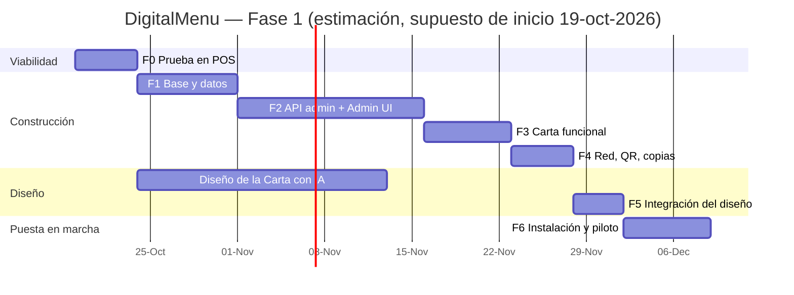

# 08 — Hoja de ruta (roadmap)

> **Supuesto:** un desarrollador (Jhon Alex) a tiempo parcial-completo; inicio el **lunes 19-oct-2026**. Las duraciones son estimaciones y se recalibrarán tras la Fase 0. El diseño de la Carta con IA de diseño puede hacerse en paralelo a las fases 1–3.

## 1. Resumen de fases e hitos

| Fase | Nombre | Duración estimada | Hito de salida |
|------|--------|-------------------|----------------|
| F0 | Prueba de viabilidad en el POS | 3–5 días | **M0** — `.exe` baseline corre en el POS, RAM medida, teléfono accede |
| F1 | Base: proyecto, datos y lógica compartida | 1–1,5 semanas | **M1** — BD con migraciones, repositorios y `money`/`i18n` probados |
| F2 | API de administración + Admin UI | 2–3 semanas | **M2** — Admin completo para categorías, productos, ofertas, monedas, idiomas |
| F3 | Carta funcional (diseño provisional) | 1–1,5 semanas | **M3** — Carta navegable en teléfonos con idioma y moneda |
| F4 | Red, QR y copias de seguridad | 1 semana | **M4** — Tarjeta QR impresa y probada; copias automáticas |
| F5 | Integración del diseño final de la Carta | 3–5 días | **M5** — Diseño de IA integrado y dentro del presupuesto de peso |
| F6 | Empaquetado, instalación y piloto | 1 semana | **M6** — Instalado en el restaurante, 1 semana de piloto sin incidencias graves |
| F7 | Fase 2 (futuro) | — | Backlog priorizado |

---

## 2. Detalle por fase

### F0 — Prueba de viabilidad en el POS (crítica)

**Objetivo:** eliminar los riesgos técnicos más grandes antes de construir.

| # | Tarea | Criterio de terminado |
|---|-------|-----------------------|
| F0.1 | Proyecto mínimo: `Bun.serve` + `bun:sqlite` + una página HTML embebida | Funciona con `bun run` en la máquina de desarrollo |
| F0.2 | Compilar con `--target=bun-windows-x64-baseline` (+ `--windows-hide-console`, `--windows-icon`) | `MenuDigital.exe` generado; anotar tamaño |
| F0.3 | Ejecutar en el **POS real** (i3-3110M) | Arranca sin error de instrucción ilegal; responde en `/api/health` |
| F0.4 | Medir RAM y CPU en reposo y con 50 peticiones | RSS anotado; si > 80 MB probar `--smol` y documentar |
| F0.5 | Probar `msedge --app=http://localhost:8080/admin` | Ventana sin barra de direcciones; anotar RAM de Edge |
| F0.6 | Acceso desde teléfono por wifi | Teléfono Android e iPhone abren `http://IP:8080/` |
| F0.7 | Verificar router: aislamiento de clientes (AP isolation) desactivado, reserva DHCP posible | Documentado modelo de router y pasos |
| F0.8 | Firewall: regla de entrada, perfil de red Privado | Regla funciona sin desactivar el firewall |
| F0.9 | Comprobar puertos de AxisPOS (`netstat -ano`) | Puerto elegido libre |
| F0.10 | Validar método de embebido de assets (`with { type: "file" }` vs `Bun.embeddedFiles`) | Método elegido y anotado en ADR-04/05 |
| F0.11 | Probar `canvas.toBlob('image/webp')` en el Edge del POS | Imagen de 4 MB → < 150 KB |
| F0.12 | Probar QR `WIFI:` impreso con Android e iOS | Ambos se unen a la red |

**Hito M0:** informe breve (1 página) con resultados; decisión "seguir" / "ajustar".

### F1 — Base: proyecto, datos y lógica compartida

| # | Tarea |
|---|-------|
| F1.1 | Estructura de carpetas (05 §6), `package.json`, `tsconfig` strict, Biome, `.gitignore` (`data/`, `dist/`) |
| F1.2 | `config.ts`: ruta de datos (`--data`, `MENUDIGITAL_DATA`, defecto), `config.json`, `--port`, `--open-admin`, `--dev` |
| F1.3 | `logger.ts`: niveles, archivo diario, rotación 30 días, buffer |
| F1.4 | `db/index.ts` con PRAGMAs; `migrate.ts`; `001_init.sql`, `002_seed.sql` |
| F1.5 | Repositorios: categories, products, offers, offer_items, translations, languages, currencies, settings, ui_strings |
| F1.6 | `shared/money.ts` (convertir, redondear, formatear) + tests exhaustivos |
| F1.7 | `shared/i18n.ts` (resolución de idioma y fallback) + tests |
| F1.8 | `shared/wifi.ts` (cadena `WIFI:` con escape) + tests |
| F1.9 | Instancia única + `/api/health` |
| F1.10 | Middlewares: `localOnly`, `securityHeaders` + tests con IP/Host/Origin simulados |

**Hito M1:** `bun test` en verde; BD creada desde cero; cobertura ≥ 80 % en `shared`.

### F2 — API de administración + Admin UI

| # | Tarea |
|---|-------|
| F2.1 | Validación de entradas (validadores/esquemas) y formato de error común (07 §1) |
| F2.2 | API categorías (CRUD, orden, visibilidad, eliminación segura) |
| F2.3 | API productos (CRUD, filtros, PATCH disponibilidad, orden, reset disponibilidad) |
| F2.4 | API imágenes (multipart, bytes mágicos, hash, escritura atómica, huérfanas) |
| F2.5 | API ofertas (CRUD, componentes, disponibilidad efectiva, ahorro) |
| F2.6 | API monedas (CRUD, tasa del día, cambio de base) |
| F2.7 | API idiomas, traducciones (estado, masivo), ui_strings |
| F2.8 | API ajustes |
| F2.9 | Admin: shell (barra lateral, router por hash, toasts, diálogos, banner) |
| F2.10 | Admin: componentes (tabla ordenable drag&drop, toggle, pestañas de idioma, campo precio con vista de conversión) |
| F2.11 | Admin: `image-compress.ts` (canvas → WebP 1000/400) |
| F2.12 | Admin: vistas Inicio, Categorías, Productos, Ofertas, Monedas, Idiomas, Ajustes (General) |
| F2.13 | `--open-admin` y `services/edge.ts` |
| F2.14 | PIN opcional (*Should*) |

**Hito M2:** el administrador puede cargar la carta completa real del restaurante (con fotos) solo con el Admin.

### F3 — Carta funcional (diseño provisional)

| # | Tarea |
|---|-------|
| F3.1 | `services/menu.ts`: composición, fallback, disponibilidad efectiva, caché por idioma, ETag/304, invalidación |
| F3.2 | Ruta `/img/:name` con validación y caché inmutable |
| F3.3 | Carta: HTML semántico, render con `textContent`, barra de categorías sticky, ofertas, agotados |
| F3.4 | Selectores de idioma y moneda con `localStorage`; detección de `navigator.language` |
| F3.5 | Detalle de producto con History API |
| F3.6 | Estados de carga/error/vacío |
| F3.7 | Diccionarios `es.json`, `en.json` + sobrescritura desde `ui_strings` |
| F3.8 | `check-budget.ts` (RNF-06) en el build |
| F3.9 | Pruebas en Android/iOS reales por wifi |

**Hito M3:** carta navegable en teléfonos reales, < 2 s de carga.

### F4 — Red, QR y copias de seguridad

| # | Tarea |
|---|-------|
| F4.1 | `services/network.ts`: detección, filtros de adaptadores, vigilancia 60 s, estado |
| F4.2 | Banner de cambio de IP en Admin y acciones (RF-37) |
| F4.3 | `services/qr.ts`: SVG nivel M; endpoints `wifi.svg`, `carta.svg` |
| F4.4 | Vista Red y QR + tarjeta imprimible (`@media print`, A6/A5, varias por hoja) |
| F4.5 | Descarga SVG/PNG |
| F4.6 | `services/backup.ts`: `VACUUM INTO`, programación diaria, rotación, copia previa a migración |
| F4.7 | Exportar/importar zip completo (`fflate`), restauración con copia de seguridad previa |
| F4.8 | Ajustes → Copias, Imágenes, Diagnóstico |

**Hito M4:** tarjeta QR impresa probada con 3+ modelos de teléfono; restauración probada.

### F5 — Integración del diseño final de la Carta

| # | Tarea |
|---|-------|
| F5.1 | Preparar *brief* para la IA de diseño: estructura (04 §B), datos de ejemplo reales, restricciones (sin frameworks, sin CDN, fuentes locales, ≤ 60 KB, WebP, móvil primero, accesibilidad AA) |
| F5.2 | Recibir HTML/CSS del diseño; adaptar a `src/carta` (eliminar dependencias externas, convertir fuentes a WOFF2 subset locales) |
| F5.3 | Conectar las plantillas del diseño con `render.ts` (sin cambiar la API) |
| F5.4 | Revisar contraste, tamaños táctiles, textos largos (traducciones), productos sin foto |
| F5.5 | Verificar presupuesto de peso y tiempo de carga |

**Hito M5:** diseño final aprobado por el restaurante.

### F6 — Empaquetado, instalación y piloto

| # | Tarea |
|---|-------|
| F6.1 | `scripts/build.ts` definitivo (versión, icono, sin consola) |
| F6.2 | `scripts/install.ps1`, `update.ps1`, `uninstall.ps1` (09) |
| F6.3 | Instalación en el POS: carpeta, firewall, tarea programada, accesos directos, energía |
| F6.4 | Reserva DHCP en el router; verificación de aislamiento de clientes |
| F6.5 | Carga de datos reales, traducciones EN, tasas |
| F6.6 | Impresión y colocación de tarjetas QR |
| F6.7 | Prueba de convivencia con AxisPOS durante un servicio completo |
| F6.8 | Prueba de reinicio del PC / corte de luz |
| F6.9 | Guía rápida de 1 página para el personal (Admin: tasa del día, agotados) |
| F6.10 | Piloto 1 semana; medición de RAM (`soak.ps1`), revisión de logs |

**Hito M6:** aceptación del restaurante; versión `1.0.0` etiquetada en Git.

---

## 3. Fase 2 y posteriores (backlog, no comprometido)

| Prioridad | Funcionalidad | Notas |
|-----------|---------------|-------|
| Alta | Ofertas por horario / día (happy hour, menú del día) | Campos `valid_from/to`, `days_mask`, `time_from/to` en `offers` |
| Alta | Pedidos desde el teléfono del cliente | Requiere carrito, estado de pedidos, pantalla en caja/cocina, posible integración con AxisPOS |
| Media | Portal cautivo (abrir la carta al conectarse al wifi) | Depende del router (p. ej. OpenWrt + nodogsplash) |
| Media | Admin desde tablet/móvil del encargado | Requiere autenticación fuerte y HTTPS o red separada |
| Media | Estadísticas (productos más vistos) | Sin datos personales |
| Media | Alérgenos e iconos dietéticos | Campos/etiquetas por producto |
| Baja | Variantes y tamaños (copa/botella, pequeño/grande) | Tabla `product_variants` |
| Baja | Conversión automática de precios al cambiar moneda base | Asistente con vista previa |
| Baja | Exportar carta a PDF imprimible | Desde el Admin |
| Baja | Integración con AxisPOS (importar productos/precios) | Estudiar formato/BD de AxisPOS |

## 4. Definición de terminado (DoD) por tarea

- Código en TypeScript strict, sin errores de `tsc --noEmit` ni de Biome.
- Pruebas `bun test` para lógica nueva (servicios, shared, validaciones).
- Requisito RF/RNF referenciado en el commit o PR (`feat(productos): RF-16 toggle agotado`).
- Probado en Edge (Admin) y en al menos un teléfono (Carta) si afecta a la interfaz.
- Documentación actualizada si cambia API, modelo de datos o despliegue.

## 5. Control de versiones

- Git con rama `main` estable y ramas `feat/*`, `fix/*`.
- Versionado semántico: `0.x` durante el desarrollo, `1.0.0` en M6.
- Etiqueta por versión instalada en el POS (`v1.0.0`), con el `.exe` adjunto a la release (o guardado en el disco de desarrollo) para poder hacer *rollback*.
- Conventional Commits (`feat:`, `fix:`, `docs:`, `refactor:`, `test:`, `build:`).
